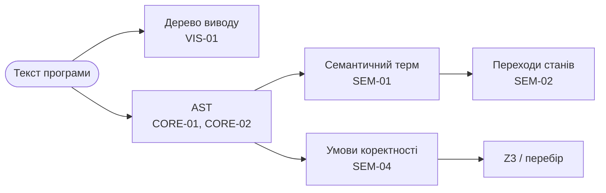

# SIPL Language Toolkit

[](https://github.com/iamlisaaay/SIPL/actions/workflows/ci.yml)

Набір інструментів для навчальної мови **SIPL** (SImple Programming Language) з курсу
«Теорія програмування» (М.С. Нікітченко; практикум Шишацької, Криволапа, Шишацького, 2024).

Трек **«Формальна семантика»**: від граматики й дерева виводу до семантичного терму,
його обчислення на станах і доведення коректності програм із циклами.



## Обрані завдання

| ID | Завдання | Бали | Де реалізовано |
|---|---|---|---|
| CORE-01 | Формальна специфікація SIPL (Lark), лексика, ≥10 позитивних і ≥10 негативних прикладів | 0.5 | [`sipl.lark`](src/sipl/grammar/sipl.lark), [`docs/spec.md`](docs/spec.md), `tests/data/` |
| CORE-02 | Парсер → типізоване AST із `SourceSpan`, діагностика синтаксичних помилок | 1.5 | [`parser.py`](src/sipl/parser.py), [`ast.py`](src/sipl/ast.py) |
| VIS-01 | Дерево синтаксичного виводу: text / JSON / DOT / SVG / HTML | 1.5 | [`visualization/`](src/sipl/visualization) |
| SEM-01 | Автоматична побудова семантичного терму в нотації курсу | 2.0 | [`semantics/build.py`](src/sipl/semantics/build.py) |
| SEM-02 | Обчислення терму на стані з покроковою трасою формул | 2.0 | [`semantics/evaluate.py`](src/sipl/semantics/evaluate.py) |
| SEM-04 | Асистент доведення часткової/повної коректності циклічних програм | 2.5 | [`prover/`](src/sipl/prover) |
| REL-01 | CI: lint, type-check, тести, збірка пакета | 0.5 | [`.github/workflows/ci.yml`](.github/workflows/ci.yml) |
| REL-02 | GitHub Release + SemVer + CHANGELOG | 0.5 | [`release.yml`](.github/workflows/release.yml), [`CHANGELOG.md`](CHANGELOG.md) |
| | **Разом заявлено** | **11.0** | зараховується максимум 10.0 |

Мінімальний CLI (`parse`, `check`, `tree`, `term`, `eval`, `prove`) потрібен, щоб усе можна було показати.
Окремі бали за CORE-05 не заявлено, щоб одна функціональність не рахувалась двічі.

## Встановлення

Потрібен Python 3.11 або новіший.

```bash
git clone https://github.com/iamlisaaay/SIPL.git
cd SIPL
python -m venv .venv
```

Активація середовища: Windows – `.venv\Scripts\activate`, Linux/macOS – `source .venv/bin/activate`.

```bash
pip install -e ".[dev]"
```

Альтернатива з [uv](https://docs.astral.sh/uv/): `uv venv && uv pip install -e ".[dev]"`.
Можна також встановити готовий wheel із GitHub Release: `pip install sipl_toolkit-1.0.0-py3-none-any.whl`.

Перевірка, що все працює:

```bash
sipl --version
```

```bash
pytest
```

## Швидкий старт

```bash
sipl check examples/power.sipl
```

```text
examples/power.sipl: синтаксично правильна програма (SIPL з розширеннями).
  змінні: R, Y, X; циклів: 1
```

**Дерево виводу** (VIS-01). Листки пронумеровано в порядку обходу, як на рис. 1 практикуму:

```bash
sipl tree examples/power.sipl
```

```text
<програма> [NP1]  @3:1-10:4
├── begin  (1)  @3:1-3:6
├── <оператор> [NS2]  @4:3-9:6
│   ├── <оператор> [NS1]  @4:3-4:9
│   │   ├── <змінна> [NV]  @4:3-4:4
│   │   │   └── R  (2)  @4:3-4:4
...
Обхід листків зліва направо:
1:begin 2:R 3::= 4:1 5:; 6:while 7:Y 8:> 9:0 10:do 11:begin ... 24:end
Отримане слово збігається з текстом програми.
```

Інтерактивний HTML: клацання по вузлу підсвічує фрагмент коду, клацання по токену – вузол.

```bash
sipl tree examples/power.sipl -f html -o power-tree.html
```

Інші формати: `-f svg`, `-f dot` (для Graphviz), `-f json`; нотація `--notation math` (P, S, a, b).

**Семантичний терм** (SEM-01):

```bash
sipl term examples/power.sipl
```

```text
AS^R(1) · WH(S2(gr, Y⇒, 0), AS^R(S2(mult, R⇒, X⇒)) · AS^Y(S2(sub, Y⇒, 1)))
```

`--explain` показує кожне застосоване правило (`NS_Stm_Seq`, `NS_A_Var`, ...),
`--explain chain` – ланцюжок рівностей `sem_P(...) = ... = терм`, а `-f latex` дає LaTeX.

**Обчислення терму на стані** (SEM-02):

```bash
sipl eval examples/power.sipl -s "X=5, Y=2" --explain
```

```text
[AF_SEQ] (AS^R(1) · WH(...))(st) = WH(...)(AS^R(1)(st))
  [AF_AS] AS^R(1)(st) = st∇[R ↦ 1(st)] = st∇[R ↦ 1] = [X ↦ 5, Y ↦ 2, R ↦ 1] = st1
  [AF_WH] S2(gr, Y⇒, 0)(st1) = gr(2, 0) = true → ітерація 1: (...)(st1)
      [AF_AS] AS^R(S2(mult, R⇒, X⇒))(st1) = st1∇[R ↦ S2(mult, R⇒, X⇒)(st1)] = st1∇[R ↦ mult(1, 5)] = ...
  ...
  [AF_WH] S2(gr, Y⇒, 0)(st5) = gr(0, 0) = false → цикл завершено після 2 ітерацій
Результат: [X ↦ 5, Y ↦ 0, R ↦ 25]
```

Невизначеність обробляється явно: незадана змінна і ділення на нуль дають «невизначено»,
а перевищення ліміту ітерацій (`--max-iterations`) – «невідомо (можливо, цикл не завершується)».

**Доведення коректності** (SEM-04). Специфікацію задає TOML-файл поруч із програмою:

```toml
# examples/power.spec.toml
pre  = "X = x ∧ Y = y ∧ y >= 0"
post = "R = pow(x, y)"

[[loop]]
invariant = "R * pow(X, Y) = pow(x, y) ∧ Y >= 0 ∧ X = x"
variant   = "Y"
```

```bash
sipl prove examples/power.sipl
```

```text
 [✓] VC1. Початкова умова (база індукції, k = 0)
 [✓] VC2. Збереження інваріанта (крок індукції k → k+1), цикл 1
 [✓] VC3. Вихід із циклу (fb(st_k) = false), цикл 1
 [✓] VC4. Обмеженість варіанта (V ≥ 0, поки цикл працює), цикл 1
 [✓] VC5. Спадання варіанта (кожна ітерація зменшує V), цикл 1
Тестування (аплікація терму) на станах з передумовою, значення у [-2, 6]: 35 з 35 пройшли
Висновок: ДОВЕДЕНО: усі умови перевірки істинні.
```

Для програми з помилкою (`examples/power_bug.sipl`) асистент знаходить контрприклад
і відтворює його на семантичному терміні:

```text
 [✗] VC2. Збереження інваріанта (крок індукції k → k+1), цикл 1
      КОНТРПРИКЛАД (перебір): R = 1, X = -1, Y = 2, x = -1, y = 0
      I(st) = true, fb(st) = true; fs(st) = [R ↦ -1, X ↦ -1, Y ↦ 0]
      I(fs(st)) = false – інваріант не зберігається
```

Кожна команда має `--json` зі стабільною схемою. Коди завершення: 0 – успіх,
1 – помилка у вхідних даних, 3 – негативний результат, 4 – результат не визначено.
Повний опис: [`docs/cli.md`](docs/cli.md).

## Приклади

| Файл | Що обчислює | Коректність |
|---|---|---|
| [`power.sipl`](examples/power.sipl) | x^y (практикум, ПР 1-3) | доведено |
| [`gcd.sipl`](examples/gcd.sipl) | НСД (підручник, теореми 1.3-1.4) | доведено |
| [`division.sipl`](examples/division.sipl) | x div y (МКР 1, розширення `>=`) | доведено |
| [`factorial.sipl`](examples/factorial.sipl) | n! | доведено |
| [`progression.sipl`](examples/progression.sipl) | 2 + 4 + ... + 2n (варіант 7) | доведено |
| [`parity.sipl`](examples/parity.sipl) | парність без div/mod (варіант 12) | доведено |
| [`fibonacci.sipl`](examples/fibonacci.sipl) | F(n) (варіант 11) | лише синтаксис і семантика |
| [`power_bug.sipl`](examples/power_bug.sipl) | навмисна помилка | спростовано з контрприкладом |

## Використання як бібліотеки

```python
from sipl import parse
from sipl.semantics.build import sem_P
from sipl.semantics.evaluate import apply_term
from sipl.semantics.terms import render

program = parse(open("examples/power.sipl", encoding="utf-8").read())
term = sem_P(program)
print(render(term))
print(apply_term(term, {"X": 5, "Y": 2}).state)   # {'X': 5, 'Y': 0, 'R': 25}
```

## Документація

* [`docs/spec.md`](docs/spec.md) – специфікація мови: БНФ курсу, лексика, пріоритети, розширення
* [`docs/semantics.md`](docs/semantics.md) – правила побудови термів і формули обчислення
* [`docs/prover.md`](docs/prover.md) – метод доведення, умови перевірки, межі автоматизації
* [`docs/cli.md`](docs/cli.md) – команди, коди завершення, JSON-схеми, коди діагностик
* [`docs/architecture.md`](docs/architecture.md) – як дані проходять через шари

## Розробка

```bash
ruff check src tests
```

```bash
mypy
```

```bash
pytest --cov
```

Покриття тестами – понад 95% (поріг у CI – 85%).

## Обмеження

* Асистент доведення не вирішує загальну задачу верифікації (вона нерозв'язна). Інваріанти й варіанти задає людина.
  Умови перевіряє Z3 у цілочисловій арифметиці, а нелінійні умови можуть залишитись «не вирішено».
  Чесний статус і межі описано в [`docs/prover.md`](docs/prover.md).
* Незавершуваність циклу при обчисленні не розпізнається, програма лише зупиняється на ліміті ітерацій.
* Розширення (`>=`, `<`, `<=`, `!=`, `∧`, `div`, `mod`, `true`, `false`) не входять у БНФ курсу.
  Прапорець `--strict` вимикає їх.

## Ліцензія

MIT, див. [LICENSE](LICENSE).
