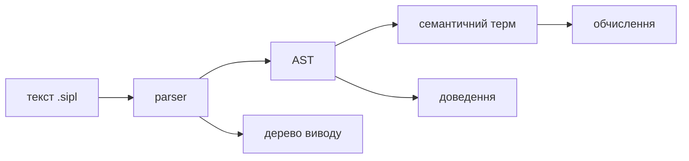

# Архітектура

Що де лежить (`src/sipl/`):

- `grammar/sipl.lark` – граматика
- `parser.py` – розбір тексту, повертає AST
- `ast.py` – класи вузлів AST
- `visualization/` – дерево виводу і експорт (text, json, dot, svg, html)
- `semantics/build.py` – будує терм
- `semantics/evaluate.py` – застосовує терм до стану
- `prover/` – доведення коректності (wp + z3)
- `cli.py` – команди `sipl ...`

Позиції в коді (рядок/колонка) є в усіх вузлах, тому помилки показують точне місце.
