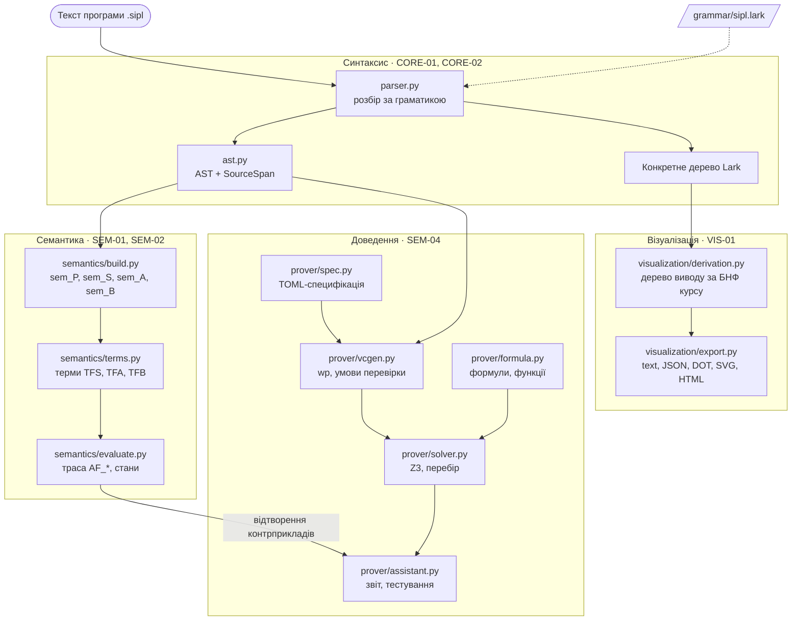

# Архітектура

`cli.py` – тонка оболонка над усім переліченим: у ній немає жодної логіки мови.

## Принципи

* **Одне джерело синтаксису.** Граматика є лише в `sipl.lark`. Усі інструменти
  користуються `parser.parse` і не дублюють розбір.
* **Lark – деталь реалізації.** Назовні виходять лише власні вузли `sipl.ast`
  і `Diagnostic`. Конкретне дерево Lark бачить тільки візуалізатор, який одразу
  переводить його в дерево виводу за БНФ курсу.
* **Позиції проходять крізь усі шари.** `SourceSpan` є у вузлів AST, вузлів дерева виводу
  (`DNode.span`), термів (`Term.origin`), кроків траси (`TraceStep.origin`) і діагностик.
  Тому будь-який рівень можна зіставити з текстом програми.
* **Один виконавець.** Обчислення програм – це аплікація семантичного терму
  (`apply_term`). Окремого інтерпретатора немає, тож тестування в асистенті доведення
  і SEM-02 використовують той самий код.
* **Стабільні контракти.** JSON зі схемами `sipl.*/1` (див. [cli.md](cli.md)) і
  коди діагностик можна використати з VS Code чи web playground без імпорту Python-коду.

## Модулі

| Модуль | Відповідальність |
|---|---|
| `span.py` | `SourceSpan`: зміщення, рядок і колонка початку та кінця |
| `diagnostics.py` | `Diagnostic`, `SiplError`, форматування з `^^^` під помилкою |
| `parser.py` | Lark (Earley) → AST; переклад помилок Lark у діагностики з підказками; діалекти core/ext |
| `ast.py` | вузли Prog/Stm/Aexp/Bexp, обходи, `unparse`, `format_program`, аналіз вхідних змінних |
| `visualization/derivation.py` | дерево виводу з мітками `<оператор>` і правилами `NS1`... |
| `visualization/export.py` | текст, JSON, DOT, власне розміщення SVG, HTML-переглядач |
| `semantics/terms.py` | модель термів, друк (Unicode/ASCII/LaTeX), JSON |
| `semantics/build.py` | правила `NS_*`, пряма побудова і покрокове пояснення |
| `semantics/evaluate.py` | формули `AF_*`, статуси defined/undefined/limit |
| `state.py` | стани, `∇`, базові функції, евклідове ділення |
| `prover/*` | специфікації, wp, Z3 і перебір, звіт |
| `cli.py` | аргументи, коди завершення, JSON-вивід |
